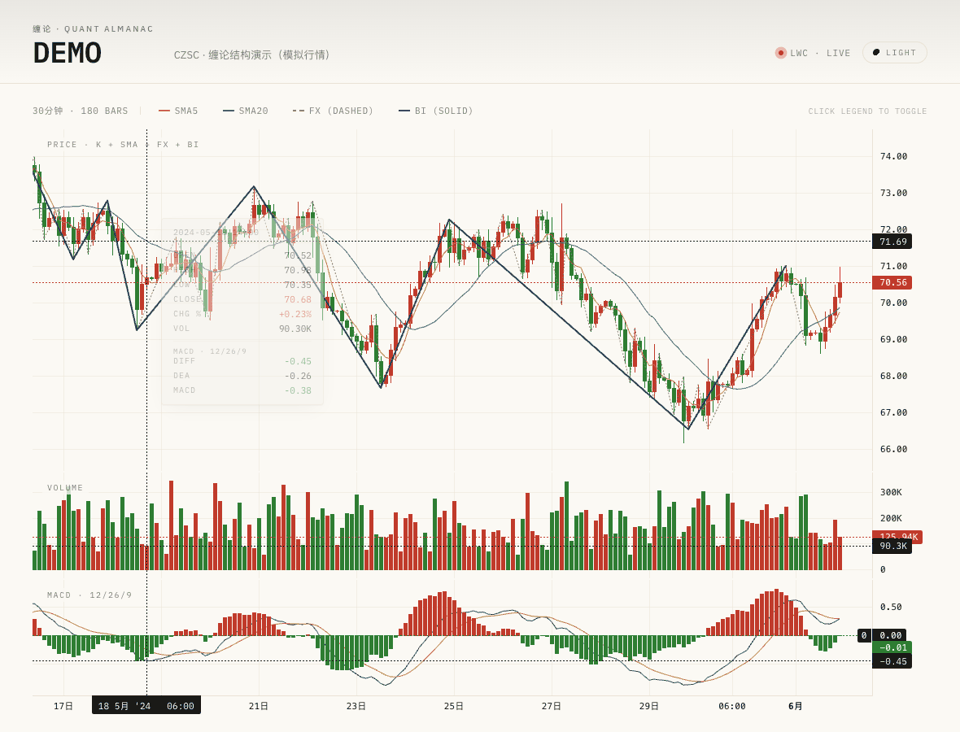

<h1 align="center">CZSC</h1>
<p align="center"><strong>把缠论结构，变成可计算的研究工具。</strong></p>
<p align="center">Rust 核心 · Python 接口 · 多周期分析 · 信号与策略研究</p>
<p align="center">
  <a href="https://pypi.org/project/czsc/"></a>
  
  
  <a href="https://pepy.tech/project/czsc"></a>
</p>
<p align="center">
  <a href="#快速开始">快速开始</a> · <a href="https://s0cqcxuy3p.feishu.cn/wiki/wikcn3gB1MKl3ClpLnboHM1QgKf">项目文档</a> · <a href="#使用案例">使用案例</a> · <a href="#交流与延伸阅读">交流与关注</a>
</p>

<a href="https://quant.shengkezhi.com/"></a>

**内测邀请码：`6293WHZ96DZ82MEJ`** · [新手路线](https://docs.shengkezhi.com/new-user-roadmap) · [研究方法](https://docs.shengkezhi.com/research-methodology) · [使用案例](https://s0cqcxuy3p.feishu.cn/minutes/obcn6m8m44515zvn24ltmu3y) · [产品介绍](https://www.shengkezhi.com/)

<a href="https://applink.feishu.cn/client/chat/chatter/add_by_link?link_token=0bak668e-7617-452c-b935-94d2c209e6cf"></a>

---

CZSC 是面向缠论分析与量化研究的开源工具：从 K 线出发，识别分型、笔与中枢，组织多周期信号，并连接策略回测与可视化。

<p align="center"></p>
<p align="center"><sub>缠论结构可视化 · 模拟行情，仅用于功能演示，不代表实盘或策略收益</sub></p>

## 你可以用它做什么

| 从哪里开始 | CZSC 提供什么 |
|---|---|
| 看清结构 | 自动识别分型、笔、中枢，把结构叠加到 K 线上 |
| 组织信号 | 使用信号函数与事件组合，把交易想法转成可计算条件 |
| 联立周期 | 合成不同周期 K 线，开展多周期分析与策略研究 |
| 验证与分享 | 连接 wbt 权重回测，输出可交互 HTML 图表与报告 |

## 快速开始

需要 **Python ≥ 3.10**。优先安装预编译包，无需先搭建 Rust 开发环境。

```bash
pip install -U czsc
```

下面用模拟行情生成第一张缠论结构图：

```python
from czsc import CZSC, Freq, format_standard_kline
from czsc.mock import generate_symbol_kines
from czsc.utils.plotting.lightweight import plot_czsc

# 模拟行情：仅用于演示
frame = generate_symbol_kines("000001", "30分钟", "20240101", "20240601", seed=42)
bars = format_standard_kline(frame, freq=Freq.F30)
chart = CZSC(bars)
plot_czsc(chart, output="html", path="czsc.html")
```

在浏览器打开 `czsc.html`，查看 K 线、分型与笔。此绘图方式需联网加载图表依赖。

> **版本提示**：1.0.X 已迁移至 Rust 核心，与 0.9.X 不兼容。旧项目请先阅读 [迁移说明](docs/migration/cleanup-non-czsc-core.md)，或查看 [0.9.X](https://github.com/waditu/czsc/tree/v0.9.69)。

## 使用案例

更多端到端案例汇总见飞书 wiki：[CZSC 1.0.X 版本使用说明和案例](https://s0cqcxuy3p.feishu.cn/wiki/X0mAwSZyqiuebek2EUacbyPMnDd)。

| 序号 | 案例 | 一句话介绍 |
|------|------|------------|
| 1 | [基于 Event 的策略回测 + wbt HTML 报告](https://s0cqcxuy3p.feishu.cn/wiki/Li7ewsbReiQlWokEEVpcvLjznJU) | 5 行命令跑通 Event → Position → 回测 → 可交互 HTML 报告的完整闭环。 |
| 2 | [lightweight_charts 缠论可视化](https://s0cqcxuy3p.feishu.cn/wiki/VF7Gwq3N8iuplckG1Tmcmp1Qn3d) | 几行代码把缠论结构（分型/笔/线段/中枢）导出为交互式 HTML，便于分享与嵌入。 |
| 3 | [把信号函数画到 K 线主图（plot_czsc_signals）](https://s0cqcxuy3p.feishu.cn/wiki/ULxhwFyVkiavqhkZ2Xkc0N3fnYc) | 把信号触发点叠在 K 线主图上，直观调试 signals_config 与多周期联立。 |
| 4 | [性能基准测试：在本地复现 CZSC / CzscTrader 吞吐量](https://s0cqcxuy3p.feishu.cn/wiki/ReRfw9WUjiVgEckZbMxcT87WnRc) | 一行命令本地评估吞吐量，配套关键指标速查表，用于容量规划与加速效果核对。 |
| 5 | [信号函数模块深入介绍](https://s0cqcxuy3p.feishu.cn/wiki/WxU8wKTBViekKbkCyKzcwa7SnJd) | 系统讲解 czsc-signals 架构与 246 个信号函数的模块划分、参数模板、信号表达示例。 |

## 进阶与开发

按需展开，不必在开始使用前读完所有 API。

<details>
<summary>进阶示例：多周期、信号生成、权重回测与策略研究</summary>

### K 线合成与多级别分析

```python
from czsc import BarGenerator, Freq

# 使用 BarGenerator 进行 K 线合成
bg = BarGenerator(base_freq='1分钟', freqs=['5分钟', '30分钟', '日线'])
for bar in raw_bars:
    bg.update(bar)

# 获取各周期 K 线
bars_5m = bg.bars['5分钟']
bars_30m = bg.bars['30分钟']
```

### 信号生成

```python
from czsc import generate_czsc_signals, get_signals_config, get_signals_freqs

# 配置信号序列（使用 Rust 实现的信号函数）
signals_seq = [
    "czsc._native.signals.bar.bar_end_V230331",
    "czsc._native.signals.cxt.cxt_bi_status_V230101",
]

# 解析信号所需的周期配置
freqs = get_signals_freqs(signals_seq)
config = get_signals_config(signals_seq)

# 生成信号序列
results = generate_czsc_signals(bars, signals_seq)
```

### 权重回测

```python
from czsc import WeightBacktest
from czsc.mock import generate_klines_with_weights

# 生成带权重的模拟数据
dfw = generate_klines_with_weights(seed=42)

# 运行权重回测
wb = WeightBacktest(dfw, fee_rate=0.0002)
print(wb.stats)  # 回测统计汇总
```

### 策略研究

```python
from czsc import run_research, run_replay

# 单品种回放
run_replay(bars, signals_seq, pos_seq, res_path='./results/')

# 批量品种研究
run_research(symbols, signals_seq, pos_seq, res_path='./results/')
```


</details>
<details>
<summary>架构与核心 API</summary>

## 架构概览

CZSC 1.0 采用 **Rust + Python 混合架构**：

```
czsc (Python 包)
├── czsc._native          ← Rust 扩展（PyO3），缠论核心
│   ├── CZSC / FX / BI / ZS / RawBar / NewBar / BarGenerator
│   ├── Freq / Mark / Direction / Signal / Event / Position / Operate
│   ├── CzscTrader / CzscSignals / generate_czsc_signals
│   ├── signals.*         ← 220+ 信号函数（Python 端 7 个子模块；详见 crates/czsc-signals/src/）
│   └── ta.*              ← Rust TA 算子 (ema/sma/boll 等，本次清理 起仅内部使用)
├── czsc.traders          ← Python 门面，汇聚 Rust 交易 API
├── czsc.utils            ← 工具函数（绘图/缓存/统计/交易工具）
├── czsc.connectors       ← 数据源连接器（天勤/Tushare/CCXT/本地缓存）
├── czsc.strategies       ← 策略门面（CzscStrategyBase/CzscJsonStrategy）
├── czsc.fsa              ← 飞书自动化工具
├── czsc.mock             ← 测试用模拟数据（转发自 wbt）
└── czsc.envs             ← 环境变量管理
```

底层 Rust workspace 包含 9 个 crate：`czsc` / `czsc-core` / `czsc-derive` / `czsc-signals` /
`czsc-trader` / `czsc-utils` / `czsc-ta` / `czsc-signal-macros` /
`czsc-python`（PyO3 绑定入口）。

## 核心 API 一览

| 类型 | 符号 | 说明 |
|------|------|------|
| **缠论对象** | `CZSC`, `FX`, `BI`, `ZS` | 缠论核心数据结构（Rust） |
| **K线对象** | `RawBar`, `NewBar`, `BarGenerator` | K线与合成器（Rust） |
| **枚举** | `Freq`, `Mark`, `Direction`, `Operate` | 方向/频率等枚举（Rust） |
| **信号/事件** | `Signal`, `Event`, `Position` | 信号与持仓逻辑（Rust） |
| **分析工具** | `check_fx`, `check_bi`, `remove_include` | 分型/笔校验工具（Rust） |
| **TA算子顶层别名** | `czsc.ema`, `czsc.sma`, `czsc.rolling_rank`, `czsc.boll_positions`, `czsc.ultimate_smoother` | 技术指标算子顶层别名（Rust） |
| **交易器** | `CzscTrader`, `CzscSignals` | 多级别交易决策（Rust） |
| **信号生成** | `generate_czsc_signals` | 批量信号生成（Rust） |
| **权重回测** | `WeightBacktest` | 权重序列回测（来自 wbt） |
| **策略** | `CzscStrategyBase`, `CzscJsonStrategy` | 策略封装（Python） |
| **模拟数据** | `generate_symbol_kines` | 测试用 K线数据（来自 wbt） |
| **格式转换** | `format_standard_kline` | DataFrame → RawBar 列表 |

</details>
<details>
<summary>数据源与可视化接口</summary>

## 数据源连接器

`czsc.connectors` 提供多个数据源适配器：

| 模块 | 数据源 | 说明 |
|------|--------|------|
| `tq_connector.py` | 天勤（TQSdk） | 期货实时/历史行情 |
| `ts_connector.py` | Tushare | A股历史数据 |
| `ccxt_connector.py` | CCXT | 数字货币交易所 |
| `local_data.py` | 投研数据本地缓存 | CZSC 共享数据本地读取入口 |

## 可视化（HTML 输出）

可视化统一以 plotly + lightweight-charts 输出 HTML：

| 模块 | 功能 |
|------|------|
| `czsc.utils.plotting.kline` | 单周期 K 线 + 缠论结构（plotly Figure） |
| `czsc.utils.plotting.weight` | 权重时序图（plotly Figure） |
| `czsc.utils.plotting.lightweight` | lightweight-charts 自包含 HTML，多周期联立 + 信号叠加 |
| 累计收益 / 回撤 / 月度热力图 / 综合回测概览 | 改用 `wbt.generate_backtest_report` 或直接 plotly，见 [`docs/migration/cleanup-non-czsc-core.md`](docs/migration/cleanup-non-czsc-core.md) |

使用 `plot_czsc`、`plot_czsc_trader` 或 `plot_czsc_signals` 生成自包含 HTML 后，可直接在浏览器中打开。

</details>
<details>
<summary>源码安装、开发与环境变量</summary>

## 安装使用

**注意：** Python 版本必须 **≥ 3.10**

从 PyPI 安装预编译版本（推荐）：

```bash
pip install czsc -U
```

使用 `uv` 安装（推荐开发环境）：

```bash
uv pip install czsc
```

从源码构建（需要 Rust 工具链和 maturin）：

```bash
# 安装 Rust：https://rustup.rs/
# 安装 maturin
pip install maturin

# 克隆并构建
git clone https://github.com/waditu/czsc.git
cd czsc
maturin develop --release
```

> **Rust 构建环境约束**：底层依赖 `pyo3` / `pyo3-stub-gen` 0.22 要求 Python ≥ 3.10。
> 当系统默认 Python 低于 3.10 时，请通过环境变量显式指定：
>
> ```bash
> export PYO3_PYTHON=$(which python3.12)   # 或任意 3.10+ 的解释器
> ```
>
> 否则 `cargo build` / `cargo test` 会在 `crates/czsc-python/build.rs` 提前 panic 并给出修复建议。
> 用 `uv sync --extra dev` 走 UV 流程时，UV 会自动选择项目声明的 Python，不需要额外设置。

## 开发环境搭建

```bash
# 使用 UV 管理依赖（推荐）
uv sync --extra dev

# 构建 Rust 扩展（开发模式）
maturin develop

# 运行测试
uv run pytest tests/ -v

# 代码格式化
uv run ruff format czsc/ tests/
uv run ruff check czsc/ tests/
```

## 关键环境变量

| 变量 | 说明 | 默认值 |
|------|------|--------|
| `CZSC_MIN_BI_LEN` | 最小笔长度 | 6 |
| `CZSC_MAX_BI_NUM` | 最大笔数量 | 50 |
| `CZSC_VERBOSE` | 是否输出详细日志 | False |

</details>

## 生态协作

**CZSC 专注结构与信号，其余环节按需组合。**

| 项目 | 定位 | 依赖关系 |
|---|---|---|
| [wbt](https://github.com/zengbin93/wbt) | 权重回测与报告 | CZSC 的运行时依赖 |
| [wmr](https://github.com/zengbin93/wmr) | 权重持久化与查询 | 下游配套，非硬依赖 |
| [talib-rs](https://github.com/0xcjun/talib-rs) | TA 算子一致性校验 | 仅测试可选 |
| [czsc_skills](https://github.com/zengbin93/czsc_skills) | CZSC 相关技能 | 按需使用 |

## 交流与延伸阅读

欢迎关注微信公众号 **「胜可知QUANT」**，交流量化研究方法、策略复现与 AI 辅助投研实践。

<p align="center"></p>


| 方向 | 文章 |
|------|------|
| 研究入门 | [不写一行代码，也能把量化研究跑完](https://mp.weixin.qq.com/s/Dk_2Al7uCfT-15ff058utQ) |
| 策略复现 | [主观策略复现：从交易经验到系统化研究](https://mp.weixin.qq.com/s/IOxKqv1R0idF6eoHaCxA5A) |
| 工具实践 | [使用 skz-auto-research skill 复现主观策略](https://mp.weixin.qq.com/s/v10rg1DikF2gjrJhqZrJ_A) |
| 策略研究 | [策略为什么会出现收益能力的衰减？](https://mp.weixin.qq.com/s/8U24OGx7SeE6ZMMKB-1IEw) |
| 研究分工 | [AI能批量做研究，研究员该把时间花在哪里？](https://mp.weixin.qq.com/s/QYGy8i3pMxYWmNp8CH_udQ) |
[B 站视频教程](https://space.bilibili.com/243682308/channel/series) · [投研数据共享](https://s0cqcxuy3p.feishu.cn/wiki/wikcnzuPawXtBB7Cj7mqlYZxpDh) · [信号编写规范](https://s0cqcxuy3p.feishu.cn/wiki/wikcnCFLLTNGbr2THqo7KtWfBkd) · [DeepWiki](https://deepwiki.com/waditu/czsc/1-overview)


## 缠论资料

<details>
<summary>原文备份、精华摘录与资料下载</summary>

* 原始博客：http://blog.sina.com.cn/chzhshch
* 网友备份：http://www.fxgan.com · https://chzhshch.blog

## 缠论精华

> 学了本ID的理论，去再看其他的理论，就可以更清楚地看到其缺陷与毛病，因此，广泛地去看不同的理论，不仅不影响本ID理论的学习，更能明白本ID理论之所以与其他理论不同的根本之处。

> 为什么要去了解其他理论，就是这些理论操作者的行为模式，将构成以后我们猎杀的对象，他们操作模式的缺陷，就是以后猎杀他们的最好武器，这就如同学独孤九剑，必须学会发现所有派别招数的缺陷，这也是本ID理论学习中一个极为关键的步骤。

> 真正的预测，就是不测而测。所有预测的基础，就是分类，把所有可能的情况进行完全分类。有人可能说，分类以后，把不可能的排除，最后一个结果就是精确的。
> 这是脑子锈了的想法，任何的排除，等价于一次预测，每排除一个分类，按概率的乘法原则，就使得最后的所谓精确变得越不精确，最后还是逃不掉概率的套子。
> 对于预测分类的唯一正确原则就是不进行任何排除，而是要严格分清每种情况的边界条件。任何的分类，其实都等价于一个分段函数，就是要把这分段函数的边界条件确定清楚。
> 边界条件分段后，就要确定一旦发生哪种情况就如何操作，也就是把操作也同样给分段化了。然后，把所有情况交给市场本身，让市场自己去当下选择。
> 所有的操作，其实都是根据不同分段边界的一个结果，只是每个人的分段边界不同而已。因此，问题不是去预测什么，而是确定分段边界。

## 原文整理

* [缠中说禅重新编排版《论语》（整理版）](https://blog.csdn.net/baidu_25764509/article/details/109517775)
* [缠中说禅交易指南](https://blog.csdn.net/baidu_25764509/article/details/109598229)
* [缠中说禅技术原理](https://blog.csdn.net/baidu_25764509/article/details/109597255)
* [缠中说禅图解分析示范](https://blog.csdn.net/baidu_25764509/article/details/110195063)
* [缠中说禅：缠非缠、禅非禅，枯木龙吟照大千（整理版）](https://blog.csdn.net/baidu_25764509/article/details/110775662)
* [缠中说禅教你打坐（整理版）](https://blog.csdn.net/baidu_25764509/article/details/113735170)

## 资料分享

* 链接：https://pan.baidu.com/s/1RXkP3188F0qu8Yk6CjbxRQ
* 提取码：vhue

</details>

## 反馈与声明

遇到问题请提交 [Issue](https://github.com/waditu/czsc/issues)，附版本、最小复现与错误信息。项目开源仅用于技术交流，不构成投资建议。
